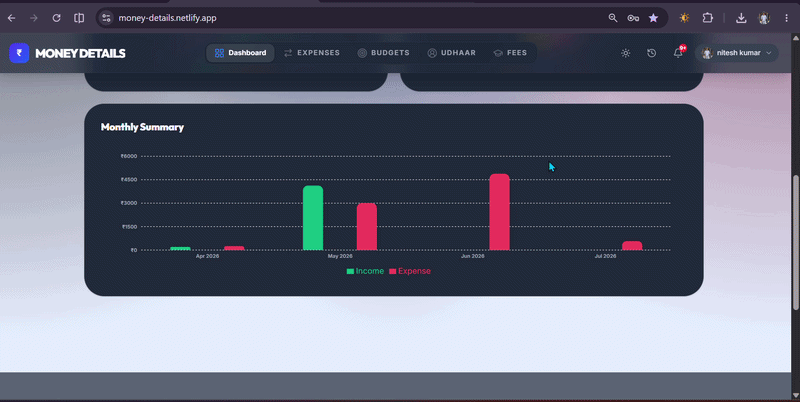
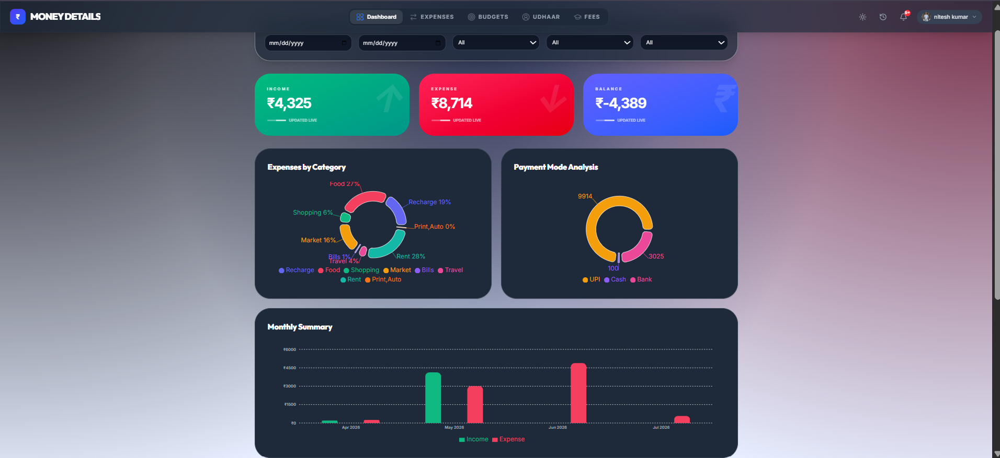
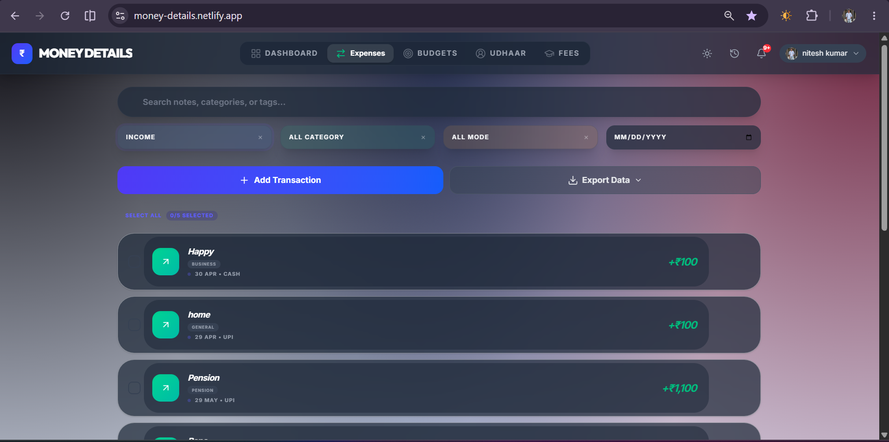
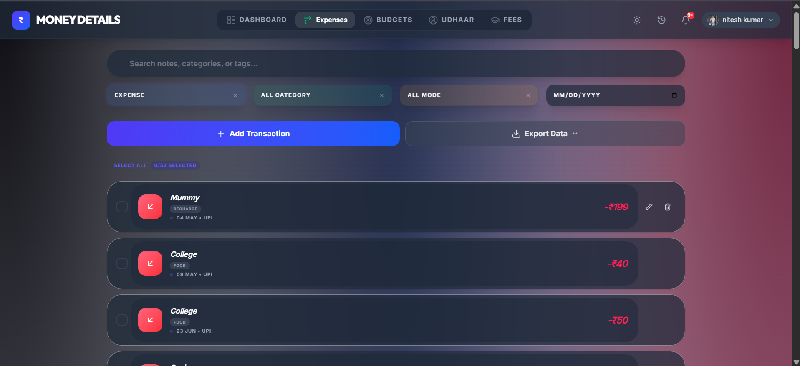
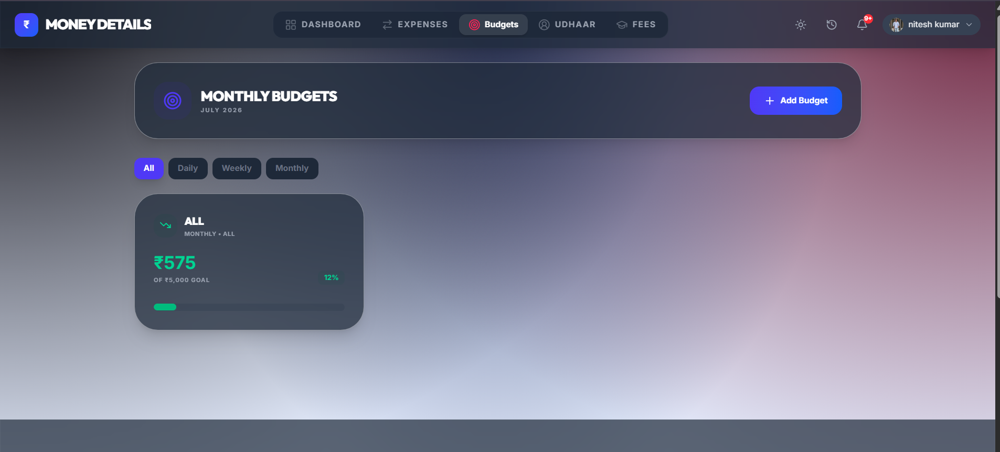
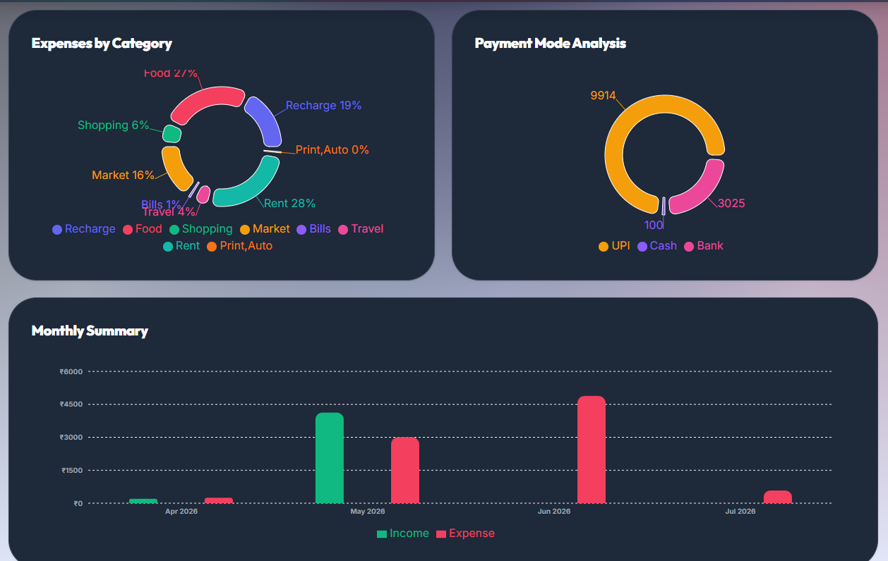

<h1 align="center">💰 Money Details</h1>

<h3 align="center">
A Modern Personal Finance Management System built with React.js
</h3>

<p align="center">

<a href="https://nitesh933438.github.io/Money-Details-Demo-Source/">

</a>

<a href="https://github.com/nitesh933438/Money-Details-Demo">

</a>


</p>

---

<p align="center">



</p>

---

# 📑 Table of Contents

- 📖 About
- ✨ Features
- 📸 Screenshots
- 🛠 Tech Stack
- 🏗 Architecture
- 📂 Folder Structure
- 🚀 Installation
- ⚙ Usage
- 📱 Responsive Design
- 📊 Performance
- 🌟 Highlights
- 🛣 Roadmap
- 🤝 Contributing
- 📄 License
- 👨‍💻 Author

---

# 📖 About

**Money Details** is a modern, responsive, and feature-rich Personal Finance Management System that helps users organize and manage their daily financial activities with ease.

The application allows users to track income, expenses, budgets, udhaar (borrow & lend), fee records, and financial insights through an elegant dashboard powered by interactive charts.

Designed with a clean UI and smooth user experience, Money Details simplifies personal finance management while providing real-time analytics, powerful search, smart filters, and data export functionality.

Whether you're managing your monthly expenses, monitoring savings, or analyzing spending habits, Money Details provides an efficient and user-friendly solution for smarter financial planning.

---

# ✨ Features

## 📊 Dashboard

- 📈 Real-time Financial Overview
- 💰 Income Summary
- 💸 Expense Summary
- 💳 Current Balance
- 📊 Monthly Statistics
- 📉 Financial Reports
- 📌 Quick Overview Cards

---

## 💰 Income Management

- ➕ Add Income
- ✏ Edit Income
- 🗑 Delete Income
- 📂 Category-wise Income
- 📅 Date Tracking
- 💳 Payment Mode
- 🔍 Search Income

---

## 💸 Expense Management

- ➕ Add Expense
- ✏ Edit Expense
- 🗑 Delete Expense
- 📂 Expense Categories
- 💳 Payment Methods
- 📅 Transaction History
- 🔍 Search Expenses

---

## 🎯 Budget Management

- 📅 Monthly Budget
- 🎯 Budget Tracking
- 💰 Remaining Budget
- 📉 Spending Analysis
- 📊 Budget Reports
- ⚠ Budget Monitoring

---

## 🤝 Udhaar Management

- 👥 Borrow Records
- 🤝 Lending Records
- 💵 Due Amount
- ✔ Payment Status
- 📅 Transaction History

---

## 🎓 Fees Management

- ➕ Add Fee Records
- 📚 Fee Categories
- ✔ Payment Tracking
- 📅 Fee History
- 📊 Fee Summary

---

## 📈 Analytics

- 🥧 Expense Category Chart
- 🍩 Payment Mode Analysis
- 📊 Monthly Income vs Expense
- 📉 Financial Reports
- 📈 Spending Insights
- 📋 Data Visualization

---

## 🔍 Smart Search & Filters

- 🔎 Search Transactions
- 📅 Date Filter
- 📂 Category Filter
- 💳 Payment Mode Filter
- 📑 Multiple Filter Support

---

## 📤 Export System

- 📁 Export Records
- 💾 Backup Financial Data
- 📤 Easy Data Management

---

## 👤 User Profile

- 👤 User Avatar
- ⚙ Account Menu
- 🔔 Notification Icon
- 🌙 Theme Toggle

---

## 🎨 User Interface

- 🌙 Dark Theme
- ✨ Modern Glassmorphism Design
- 📱 Fully Responsive Layout
- ⚡ Fast Performance
- 🎯 Clean User Experience
- 🎨 Beautiful Color Palette

---

# 🖼 Screenshots

## 🏠 Dashboard

<p align="center">

</p>

A beautiful dashboard providing a complete financial overview with summary cards, analytics, and quick access to every module.

---

## 💰 Income Management

<p align="center">

</p>

Manage all income records with category-wise organization, payment methods, and transaction history.

---

## 💸 Expense Management

<p align="center">

</p>

Track daily expenses efficiently with smart categories and detailed expense reports.

---

## 🎯 Budget Management

<p align="center">

</p>

Monitor monthly budgets, remaining balance, and spending progress.

---

## 📊 Financial Analytics

<p align="center">

</p>

Interactive charts provide insights into income, expenses, payment methods, and overall financial health.

---

## 🎥 Project Demo

<p align="center">

</p>

A quick preview showcasing the application's workflow and user interface.

---

# 🛠 Tech Stack

## 🎨 Frontend

<p align="left">


</p>

---

## 📊 Charts & Visualization

- Chart.js
- React Chart.js 2

---

## 💾 Storage

- Local Storage
- Browser Storage API

---

## ⚡ Development Tools

<p align="left">


</p>

---

## ☁ Deployment

- Netlify

---

# 🏗 Project Architecture

```text
                   Money Details

                         │

        ┌────────────────┼────────────────┐

        │                │                │

   Components         Pages          Context API

        │                │                │

        └────────────────┼────────────────┘

                         │

                     Services

                         │

                     Utilities

                         │

                   Local Storage

                         │

                    Browser UI
```

---

# 📂 Folder Structure

```text
Money-Details
│
├── assets
│   ├── dashboard.png
│   ├── income.png
│   ├── expense.png
│   ├── budget.png
│   ├── chart.png
│   └── demo.gif
│
├── public
│
├── src
│
│   ├── assets
│
│   ├── components
│
│   ├── context
│
│   ├── hooks
│
│   ├── pages
│
│   ├── services
│
│   ├── utils
│
│   ├── App.jsx
│
│   └── main.jsx
│
├── package.json
│
├── vite.config.js
│
└── README.md
```

---

# 🚀 Getting Started

Follow the steps below to run the project locally.

### 1️⃣ Clone Repository

```bash
git clone https://github.com/nitesh933438/Money-Details-Demo.git
```

### 2️⃣ Navigate to Project

```bash
cd Money-Details-Demo
```

### 3️⃣ Install Dependencies

```bash
npm install
```

### 4️⃣ Start Development Server

```bash
npm run dev
```

### 5️⃣ Build Production Version

```bash
npm run build
```

### 6️⃣ Preview Production Build

```bash
npm run preview
```

---

# ⚙️ Usage Guide

After starting the application, you can use all finance management modules from the sidebar.

### 🏠 Dashboard

- View Total Balance
- Monitor Monthly Income
- Track Monthly Expenses
- Check Budget Status
- View Financial Analytics

---

### 💰 Income

- Add New Income
- Edit Existing Income
- Delete Income
- Search Income
- Filter by Category
- View Income History

---

### 💸 Expenses

- Add Daily Expenses
- Edit Expenses
- Delete Expenses
- Search Expenses
- Filter by Category
- Track Spending

---

### 🎯 Budget

- Create Monthly Budget
- Update Budget
- Track Remaining Amount
- Monitor Spending
- View Budget Statistics

---

### 🤝 Udhaar

- Add Borrow Records
- Add Lending Records
- Update Payment Status
- Delete Records
- Track Due Amount

---

### 🎓 Fees

- Add Fee Details
- Update Fee Records
- Delete Records
- Monitor Payment Status

---

### 📈 Analytics

- Expense Distribution
- Income Distribution
- Monthly Comparison
- Financial Overview
- Interactive Charts

---

### 📤 Export

- Export Financial Records
- Backup Data
- Download Reports

---

# 📱 Responsive Design

Money Details is fully responsive and optimized for every device.

✅ Desktop

✅ Laptop

✅ Tablet

✅ Mobile

### Supported Browsers

- Google Chrome
- Microsoft Edge
- Mozilla Firefox
- Brave Browser
- Opera
- Safari

---

# ⚡ Performance

### Optimized Features

- ⚡ Fast Loading
- ⚡ Optimized Rendering
- ⚡ Lightweight Components
- ⚡ Efficient State Management
- ⚡ Responsive UI
- ⚡ Smooth Animations

---

# 🔐 Data Security

Although the current version uses Local Storage, your data remains stored securely within your browser.

Features include:

- Local Data Storage
- No Third-party Tracking
- Fast Offline Access
- Secure Browser Storage

---

# 🌟 Project Highlights

✔ Modern Finance Dashboard

✔ Beautiful User Interface

✔ Fully Responsive Layout

✔ Interactive Charts

✔ Smart Budget Tracking

✔ Income & Expense Management

✔ Udhaar Management

✔ Fee Management

✔ Search & Filter

✔ Export Data

✔ Fast Performance

✔ Easy Navigation

✔ Dark & Light Theme

✔ Clean Code Structure

✔ Beginner Friendly

---

# 🌍 Live Demo

### 🚀 Website

[nitesh933438.github.io/Money-Details-Demo-Source](https://nitesh933438.github.io/Money-Details-Demo-Source/)

---

# 🎯 Roadmap

### Version 1.0 ✅

- Dashboard
- Income
- Expense
- Budget
- Analytics
- Fees
- Udhaar
- Export

---

### Version 2.0 🚧

- Firebase Database
- User Authentication
- Cloud Backup
- Notifications
- Multi User Support
- Better Analytics

---

### Version 3.0 🔮

- AI Financial Insights
- PDF Report Generator
- Excel Export
- Expense Prediction
- Mobile App
- PWA Support
- Voice Assistant
- Dark Theme Enhancements

---

# 💡 Future Improvements

- 🔐 Authentication
- ☁ Firebase Integration
- 📄 PDF Reports
- 📊 Excel Export
- 📱 Android App
- 🍎 iOS App
- 🌐 Cloud Sync
- 👨‍👩‍👧 Multi User
- 📅 Calendar View
- 📈 Advanced Analytics
- 🤖 AI Spending Suggestions
- 🔔 Smart Notifications
- 💳 Online Payment Tracking
- 🌍 Multi-language Support

---

# 📊 Project Status

🟢 Active Development

Regular updates and new features are continuously being added to improve the project.

---

# 🤝 Contributing

Contributions are always welcome!

If you'd like to improve **Money Details**, follow these steps:

### Fork the repository

```bash
git clone https://github.com/nitesh933438/Money-Details-Demo.git
```

### Create a new branch

```bash
git checkout -b feature/your-feature-name
```

### Commit your changes

```bash
git commit -m "Add your feature"
```

### Push to GitHub

```bash
git push origin feature/your-feature-name
```

### Open a Pull Request

After pushing your changes, create a Pull Request describing what you've improved.

---

# 📝 License

This project is licensed under the **MIT License**.

You are free to:

- ✅ Use
- ✅ Modify
- ✅ Share
- ✅ Learn from the source code

---

# 👨‍💻 Author

## Nitesh Kumar

**Aspiring Full Stack Developer | MERN Stack Enthusiast | B.Tech CSE Student**

---

### 📬 Contact

📧 **Email**

nitesh933438@gmail.com

🌐 **Portfolio**

https://nitesh933438.github.io/My-Portfolio/

💼 **LinkedIn**

https://www.linkedin.com/in/nitesh933438

💻 **GitHub**

https://github.com/nitesh933438

---

# 🌟 Featured Projects

### 💰 Money Details

A modern Personal Finance Management System.

🌍 Live

[nitesh933438.github.io/Money-Details-Demo-Source](https://nitesh933438.github.io/Money-Details-Demo-Source/)

📂 Source

https://github.com/nitesh933438/Money-Details-Demo

---

### 🌐 Personal Portfolio

Portfolio showcasing my skills, projects and journey.

🌍 Live

https://nitesh933438.github.io/My-Portfolio/

📂 Source

https://github.com/nitesh933438/My-Portfolio

---

# ⭐ Support

If you found this project useful,

please consider giving it a ⭐ on GitHub.

It motivates me to build more open-source projects.

---

# 💙 Connect With Me

<p align="center">

<a href="https://github.com/nitesh933438">

</a>

<a href="https://www.linkedin.com/in/nitesh933438">

</a>

<a href="https://nitesh933438.github.io/My-Portfolio/">

</a>

<a href="mailto:nitesh933438@gmail.com">

</a>

</p>

---

# ❤️ Acknowledgements

Special thanks to the amazing open-source community and the developers behind:

- React
- Vite
- Chart.js
- GitHub
- Netlify
- Shields.io
- Skill Icons

for providing incredible tools that made this project possible.

---

<p align="center">

### ⭐ Thank You for Visiting ⭐

If you enjoyed this project,

don't forget to leave a ⭐ on the repository.

Happy Coding 🚀

</p>

<p align="center">


</p>
